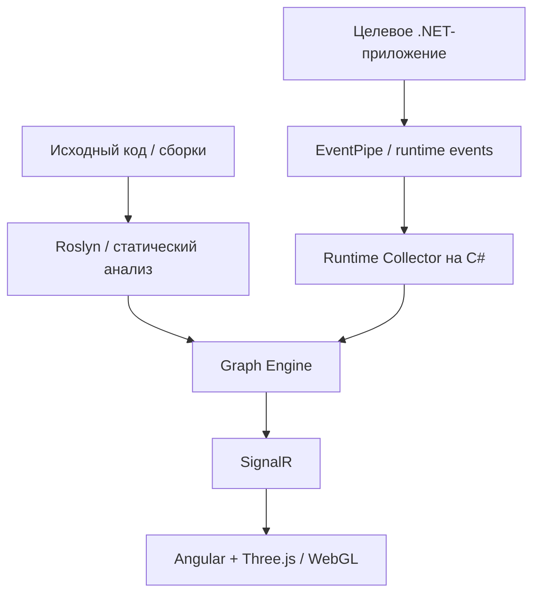

# CodeOrganism — контекст проекта для продолжения разработки

**Дата обсуждения:** 27 ноября 2026 года  
**Статус:** идея и предварительная концепция; реализация не начата.  
**Назначение документа:** перенос контекста из временного чата в постоянный. Это содержательный конспект всех обсуждённых направлений и решений, а не утверждённая техническая спецификация или дословная стенограмма.

## 1. Исходная идея пользователя

> Визуализация работы программы в реальном времени, где наиболее активные участки кода подсвечиваются сильнее. Под наиболее активными считаются те, вызовы которых происходят чаще, аллоцируют больше памяти и т. д. Пример на фото. Есть ли уже такие проекты?

Пользователь приложил визуальный референс: на чёрном фоне изображён сложный органический граф из фиолетовых светящихся ветвей, с ярким центральным стволом, множеством тонких связей и текстовыми обозначениями отдельных узлов. Визуально он напоминает нервную систему или живой организм. Само изображение не является доказательством того, что изображённый инструмент работает с runtime-метриками.

Ключевая идея — представить исполнение программы как живую карту её архитектуры. Активность должна быть не декоративной анимацией, а визуальным отображением реальных измеряемых показателей. Чем активнее конкретный участок кода, тем сильнее он выделяется в соответствующем режиме визуализации.

Оригинальный референс желательно приложить к новому чату отдельно (он предоставлен также отдельным PNG-файлом при переносе).

## 2. Название и согласованная концепция

Рабочее название — **CodeOrganism**. Пользователь сказал:

> CodeOrganism звучит неплохо и все описанные тобой фичи довольно точно отображают мою идею.

Это подтверждает общее направление и набор предложенных возможностей, но не утверждает каждое конкретное техническое решение, приоритет или объём MVP.

Предложенный англоязычный слоган: **See your software come alive.**  
Подзаголовок: **Real-time runtime visualization & profiling.**

Другие обсуждавшиеся варианты названия: CodePulse, RuntimeAtlas, NeuroTrace, LiveGraph. Проверка доступности названия CodeOrganism, доменов, товарных знаков и одноимённых репозиториев ещё не проводилась.

CodeOrganism находится на пересечении следующих направлений:
- Dynamic Software Visualization — динамическая визуализация программного обеспечения;
- Real-time Profiling — профилирование в реальном времени;
- Call Graph Visualization — визуализация графов вызовов;
- Runtime Observability — наблюдение за поведением приложения во время исполнения.

Отличие от привычных профилировщиков — не отказ от традиционных измерений, а визуальное представление работающей программы как цифрового организма. Обычные таблицы, Flame Graph и деревья вызовов могут дополнять, а не заменять основную визуализацию.

## 3. Философия цифрового организма

| Метафора | Техническое значение |
|---|---|
| Анатомия | Архитектура и структура исходного кода |
| Нервная система | Связи между методами и компонентами |
| Нервные импульсы | Вызовы методов |
| Метаболизм | Потребление процессорного времени и памяти |
| Сердцебиение | Интенсивность исполнения программы |
| Повреждения | Исключения, ошибки и аномалии |
| Регенерация | Работа сборщика мусора |
| Спящие участки | Код, неактивный в текущей сессии |

Важно: метафора служит интерфейсу и пониманию программы, а не подменяет измеряемые данные.

## 4. Обзор ранее обсуждённых аналогов

В предыдущем ответе были перечислены следующие проекты. Ни один из них не запускался и не тестировался лично. Ссылки и описания перенесены из обсуждения; при подготовке этого файла повторная проверка документации, актуальности, лицензий и доступности не выполнялась. Возможности, статус и совместимость следует проверить перед заимствованием решений. Отсутствие известного полного аналога не означает доказанной уникальности CodeOrganism.

### Luciole
- Python; в предыдущем обзоре указан Open Source, MIT.
- Идея: функции представлены нейронами, а связи между ними отражают потоки данных; узлы и связи подсвечиваются при исполнении.
- В обзоре отмечены многопоточность, асинхронные задачи, 3D-визуализация и VS Code; проект описан как находящийся на ранней стадии.
- Основной референс нейронного визуального представления кода.
- https://pypi.org/project/luciole/

### Glassbox
- Python; в предыдущем обзоре указан Open Source, ISC.
- Интерактивный веб-интерфейс профилирования, нагрузка функций, потребление памяти, тепловая карта строк кода, трёхмерный граф вызовов с импульсами.
- Основной функциональный референс.
- https://github.com/acidvegas/glassbox

### CodePerspective
- .NET; в предыдущем обзоре указан Open Source, MIT.
- Визуализация исполнения .NET-приложений с помощью анализа сборок и внедрения инструкций для сбора информации.
- Технический референс инструментирования. Совместимость с современным .NET требует отдельного изучения.
- https://github.com/swax/CodePerspective
- https://youtu.be/s3Y06R4d3F8

### Cinder
- В предыдущем обзоре описан как исследовательский проект для .NET 8+ и Windows.
- Подключение к уже запущенному процессу; визуализация аллокаций, свечение активных участков, эффекты событий GC, выделение проблемных участков.
- В обзоре указаны EventPipe, Direct3D 11, запись и воспроизведение сессий.
- Референс сбора телеметрии и визуальных эффектов.
- https://github.com/Fortitude-Group/Cinder

### ExplorViz
- Open Source; OpenTelemetry.
- Трёхмерный город программного обеспечения: пакеты и классы представлены районами и зданиями, визуализируется взаимодействие компонентов.
- В обзоре отмечены использование данных исполнения и тепловые карты.
- https://explorviz.dev/
- https://github.com/ExplorViz

### CodeGlass
- Julia; runtime profiler.
- В предыдущем обзоре указаны отслеживание числа вызовов, времени исполнения, выделения и освобождения памяти, ветвей, циклов, исключений и GC во время исполнения.
- https://julia.codeglass.io/

### Сводное сравнение из предыдущего обсуждения

| Проект | Live-режим | Граф связей | Аллокации | Платформа |
|---|---|---|---|---|
| Luciole | Да | Да | Не подтверждено | Python |
| Glassbox | Да | Да | Да | Python |
| CodePerspective | Да | Да | Не подтверждено | .NET |
| Cinder | Да | Дерево | Да | .NET |
| ExplorViz | Да | Да | Не подтверждено | OpenTelemetry |
| CodeGlass | Да | Дерево | Да | Julia |
| CodeOrganism (концепция) | Да | Да | Да | Сначала .NET (предложение); другие языки потенциально |

Три основных референса, предложенных для дальнейшего изучения: Luciole (нейронное представление), Cinder (телеметрия и эффекты), Glassbox (функциональность профилировщика).

## 5. Функциональность конечного продукта

Все перечисленные возможности обсуждались как образ конечного продукта; их включение в конкретную версию ещё не определено.

| Направление | Возможности |
|---|---|
| Подключение | Выбор уже запущенного поддерживаемого процесса |
| Визуализация | Живой интерактивный граф в 2D и 3D |
| Профилирование | CPU, память, частота вызовов, исключения, GC |
| Навигация | От приложения до отдельных компонентов и методов |
| Инспектор | Подробные метрики выбранного узла |
| История | Запись, перемотка, воспроизведение исполнения |
| Сравнение | Сопоставление двух сессий профилирования |
| Аналитика | Поиск аномалий и узких мест |
| Интеграция | Переход из графа к исходному коду в IDE |
| Экспорт | Изображения, видео, отчёты, сессии |

Предложенные уровни детализации:

**Приложение → проект → пространство имён → класс → метод → строка кода.**

Возможность получить достоверное соответствие до строки кода зависит от наличия символов отладки, способа сбора данных и особенностей JIT. Это не гарантированная функция первого релиза.

Иерархическое группирование важно, чтобы большие приложения с тысячами методов не превращались в нечитаемый клубок связей. Пользователь должен иметь возможность изучать и общую архитектуру, и отдельные подсистемы.

## 6. Визуальные эффекты и UX

| Эффект | Предложенное значение |
|---|---|
| Яркость узла | Частота вызовов метода или интенсивность выбранной метрики |
| Размер узла | Потребление ресурсов |
| Толщина связи | Интенсивность вызовов между методами |
| Движущиеся частицы | Поток вызовов |
| Красные вспышки | Исключения |
| Пульсация | Текущая активность |
| Затухание | Отсутствие недавних вызовов |
| Волна по графу | Событие сборки мусора |
| Цвет узла | Принадлежность к модулю |

Эти соответствия пока предварительные. Необходимо уточнить, как совмещаются цвет модуля, цвет выбранной метрики и сигналы исключений, а также как нормализовать разные метрики. Нельзя смешивать частоту вызовов, CPU и память в неинтерпретируемую «активность» без понятных правил.

В чате был показан интерактивный демонстрационный макет Runtime Visualizer: тёмный фон, светящиеся органические связи, узлы и движущиеся импульсы. Макет позволял переключать режимы «Вызовы», «CPU», «Память», «Ошибки», выбирать метод кликом, видеть его статистику и останавливать/возобновлять анимацию.

Демонстрационные цвета: фиолетовый для вызовов, голубой для CPU, оранжевый для памяти, красный для исключений. Это варианты для обсуждения, не утверждённая палитра.

Пример архитектуры на макете (синтетический OrderApi.exe): Program, Middleware, AuthService, OrdersController, UsersController, OrderService, UserService, CacheService, OrderRepository, PaymentService, JsonSerializer, DbContext, PostgreSQL, BackgroundWorker, Logger, GarbageCollector, NotificationService, Validation, HttpClient, Mapping. Выбор OrderService показывал условные метрики, в том числе вызовов/сек, CPU time и аллокации/сек. Все значения в макете искусственные, не результаты реального профилирования. Сам виджет был демонстрацией интерфейса, а не рабочим приложением.

В отдельном концептуальном изображении бренда CodeOrganism использовался тёмный фон, фиолетовый светящийся ствол с органическими ответвлениями и слоган See your software come alive.

### Система эталонов дизайна

До масштабной реализации предлагается согласовать визуальные эталоны: состояния графа, интерфейс, способы группировки узлов, визуальные сигналы метрик, поведение при навигации. Зафиксировать в DESIGN.md, чтобы coding-агенты не превратили уникальную концепцию в обычный мониторинговый дашборд и не создавали противоречивые экраны. Стиль должен оставаться эстетически органическим, но читаемым, пригодным для диагностики и работы с реальными данными.

## 7. Предварительная техническая архитектура

Предложено начать с .NET, поскольку пользователь знаком с C#/.NET. Не пытаться сразу поддерживать все языки. Остальные платформы — потенциальное направление развития, не обязательство.

Схема концептуальная: отдельные runtime-события собираются из целевого процесса, а статическая структура извлекается из доступных исходников или сборок. Roslyn прежде всего работает с исходным кодом и семантической моделью, не следует предполагать, что исходники всегда доступны при подключении к процессу. Связь статических и наблюдаемых runtime-узлов требует собственной логики сопоставления.

- **Runtime Collector:** подключение к процессу, чтение и обработка событий, статистических выборок, стеков, исключений, событий аллокаций и GC.
- **Graph Engine:** агрегация телеметрии, построение и обновление графа, метрики узлов и рёбер, затухание активности, группировка.
- **SignalR:** потоковая доставка обновлений интерфейсу, если выбран веб-интерфейс и соответствующее разделение на backend/frontend.
- **Visual Engine:** интерактивный рендеринг, пространственная раскладка графа, анимация, управление камерой/масштабом, выбор узлов и режимы метрик.

### Инструменты-кандидаты

| Инструмент | Назначение | Ссылка |
|---|---|---|
| EventPipe | Runtime-события .NET | https://learn.microsoft.com/en-us/dotnet/core/diagnostics/eventpipe |
| Microsoft.Diagnostics.NETCore.Client | Подключение к поддерживаемым .NET-процессам | https://learn.microsoft.com/en-us/dotnet/core/diagnostics/diagnostics-client-library |
| TraceEvent / PerfView | Обработка диагностических событий | https://github.com/microsoft/perfview |
| Roslyn | Анализ исходного кода | https://github.com/dotnet/roslyn |
| CLR Profiling API | Более точное инструментирование вызовов | https://github.com/dotnet/runtime/blob/main/docs/design/coreclr/botr/profiling.md |
| SignalR | Передача обновлений | https://learn.microsoft.com/en-us/aspnet/core/signalr/introduction |
| Angular | Возможный веб-интерфейс | https://angular.dev/ |
| Three.js | 3D-графика | https://threejs.org/ |
| 3d-force-graph | Пространственная раскладка графов | https://github.com/vasturiano/3d-force-graph |
| Sigma.js | Производительная визуализация 2D-графов | https://www.sigmajs.org/ |

Angular, SignalR, конкретные графические библиотеки и форма приложения — кандидаты, а не утверждённый стек. Не определено, будет ли продукт десктопным, веб-приложением с локальным backend или интеграцией в IDE.

### Критический нюанс: sampling и точное инструментирование

EventPipe позволяет собирать диагностические данные из поддерживаемых запущенных .NET-процессов без обязательного изменения исходного кода. Однако статистические выборки стеков **не равнозначны точному числу вызовов**. Короткие методы могут не попасть в выборку; распределение CPU определяется характером и частотой семплирования. События аллокаций могут быть выборочными и не равны полному учёту каждой аллокации или объёму живых объектов в куче. Возможности подключения зависят от runtime, разрешений и конфигурации процесса.

Для получения точных счётчиков вызовов потенциально потребуется CLR Profiling API, IL-инструментирование или иная подходящая техника. Возможность подключения к уже запущенному приложению, JIT/inlining, асинхронные методы и overhead нужно исследовать отдельно. Нельзя обещать абсолютную точность, универсальный attach или нулевую нагрузку на целевой процесс.

Важно явно различать измеренные, оценочные и недоступные метрики; не представлять частоту появления в sampled stack как реальную частоту вызовов.

### Главные технические трудности

- Минимизация влияния профилировщика на исследуемую программу.
- Читаемость и стабильность графа при тысячах методов.
- Обработка высокочастотного потока событий, агрегация и обновление интерфейса без отрисовки каждого события отдельно.
- Разграничение статического графа возможных вызовов и графа фактически наблюдавшихся вызовов.
- Корректная интерпретация CPU, аллокаций, памяти, исключений и GC.

Последние пункты — уточнения для будущего проектирования, а не уже выбранные алгоритмы.

## 8. Пользовательские сценарии

- Оптимизация: выявление узких мест, чрезмерных вызовов, аллокаций.
- Изучение чужого кода: наблюдение за работой архитектуры во время использования программы.
- Поиск ошибок: аномальные цепочки вызовов, исключения.
- Нагрузочное тестирование: изменения активности под нагрузкой.
- Обнаружение участков, не наблюдавшихся в текущей сессии. Это не доказательство того, что код никогда не используется; sampling тоже может пропускать вызовы.
- AI-разработка: проверка того, как фактически работает архитектура, написанная агентом.
- Обучение: наглядное объяснение DI, Middleware, EF Core, асинхронности и других механизмов.
- Демонстрация проектов: экспорт анимаций реальной работы приложения.

## 9. Предварительные принципы продукта

Предложены, но ещё не утверждены отдельно пользователем:
- Open Source.
- Локальная работа, без обязательных облачных сервисов.
- Минимальное вмешательство в исследуемое приложение.
- Модульная архитектура.
- Первоначальная поддержка .NET.
- Визуальные эффекты основаны на наблюдаемых показателях, а не произвольных анимациях.

Основной компромисс: глубина и точность профилирования, нагрузка на целевое приложение и красота/производительность визуализации.

## 10. Предложенная дорожная карта

Это последовательность направлений, а не утверждённый план разработки. В частности, минимальный красивый граф уже нужен на PoC/MVP, а Visual Engine означает его дальнейшее развитие.

### Этап 1 — Proof of Concept
- Подключиться к тестовому .NET-процессу.
- Получить реальные диагностические события.
- Построить первый живой граф на реальных данных.
- Проверить техническую реализуемость и ограничения выбранных метрик.

### Этап 2 — MVP
- Подключение к произвольным поддерживаемым .NET-приложениям.
- Переключение доступных метрик.
- Интерактивный граф и инспектор методов.
- Базовая навигация по структуре программы.
- Точный состав MVP нужно определить после обсуждения и PoC.

### Этап 3 — Visual Engine
- Собственный визуальный стиль.
- Органические связи, свечение, импульсы.
- Пространственная группировка и плавное масштабирование.
- Читаемость при больших графах.

### Этап 4 — Advanced Profiling
- Более точное инструментирование вызовов.
- Запись и воспроизведение сессий.
- Сравнение производительности.
- Расширенная аналитика и аномалии.

### Этап 5 — Ecosystem
- Интеграции с IDE.
- Расширяемый API и плагины.
- Потенциальная поддержка других языков программирования.

## 11. Предварительная оценка сложности

Условная субъективная шкала, не измеренные трудозатраты:

| Направление | Оценка из обсуждения |
|---|---|
| Базовые runtime-метрики | 30/100 — низкая/средняя |
| Статический анализ | 45/100 — средняя |
| Динамический граф вызовов | 65/100 — выше средней |
| Визуализация и анимации | 70/100 — высокая |
| Точный учёт каждого вызова | 90/100 — очень высокая |
| Поддержка разных языков | 100/100 — очень высокая |

Проект может быть полезен как самостоятельный open-source инструмент и портфолио: системное программирование, устройство .NET, профилирование, многопоточность, оптимизация, потоковая обработка, теория графов, графический рендеринг.

## 12. Открытые вопросы для Grill Me

Ниже рабочие темы для будущих раундов, а не уже полученные ответы пользователя. Предложено провести 5–6 раундов, не начинать полноценную реализацию до определения границ проекта.

### Раунд 1 — Концепция и аудитория
- Основной приоритет: практический профилировщик, визуализация архитектуры, образовательный инструмент или их сочетание?
- Кто целевой пользователь и какие ключевые задачи он решает?
- Что является обязательным для первой версии, а что можно отложить?
- Утверждаются ли название, Open Source, локальная работа, лицензия?

### Раунд 2 — Подключение, метрики и точность
- Только современный .NET или другие runtime в перспективе? Какие ОС?
- Attach к запущенному процессу, запуск через CodeOrganism или оба режима?
- Какие метрики обязательны? Sampling или точные счётчики, либо выбор режима?
- Допустима ли инструментированная сборка и каков приемлемый overhead?
- Что делать при недоступных исходниках/символах, отсутствии данных и ограничениях прав?

### Раунд 3 — Граф и модель данных
- Узлы: проект, модуль, namespace, класс, метод, строки?
- Граф фактических вызовов, статическая структура или их сочетание?
- Как представлять неактивный код, внешние библиотеки, фоновые потоки, async и рекурсию?
- Как агрегировать частоту вызовов, CPU и память? Интервалы, нормализация, затухание?
- Как ограничивать граф, сохранять стабильную раскладку и избегать визуального шума?

### Раунд 4 — Визуальный стиль и UX
- Приоритет 2D или 3D, либо оба?
- Как должен выглядеть граф: органическая нервная система, иерархия, облако, альтернативные представления?
- Цвета, яркость, толщина, движение, исключения, GC, легенда, фильтры, инспектор.
- Что делать с высокочастотными событиями и как избежать избыточной анимации?
- Навигация, поиск, масштаб, выбор узла, пауза.
- Эталоны интерфейса, DESIGN.md.

### Раунд 5 — Архитектура и технологические ограничения
- Форма приложения (desktop, local web, IDE, другое).
- Разделение сбора данных, агрегации и визуального движка.
- Библиотеки и транспорт; проверка альтернатив экспериментами, а не выбор по привычке.
- Управление нагрузкой, памятью, очередями, потерей событий, жизненным циклом процесса.
- Формат и хранение сессий, возможное наличие чувствительных данных в телеметрии.

### Раунд 6 — План разработки и качество
- Конкретные границы PoC и MVP, критерии завершения этапов.
- Тестовые приложения, синтетические нагрузки и проверка точности метрик.
- Как измерять overhead, пропускную способность, FPS и читаемость графа.
- Когда делать запись/сравнение/экспорт/IDE-интеграцию.
- Спецификации, этапы разработки, система эталонов и работа с coding-агентами.

## 13. Следующий шаг и рабочий процесс

Пользователь предпочитает работу с coding-агентами через Orca, в том числе Codex. Для крупных проектов полезны предварительное обсуждение, подробная спецификация, разбиение разработки на этапы и заранее согласованные визуальные эталоны. Не переносить автоматически технические ограничения других проектов в CodeOrganism.

Предложенный следующий шаг — начать полноценную Grill Me сессию. В процессе не считать предварительные рекомендации утверждёнными требованиями. После согласования основных решений составить спецификации для разработки через Codex в Orca. До этого целесообразно исследовать референсы и диагностические механизмы, при необходимости подготовить небольшие технические эксперименты.

## 14. Сообщение для нового постоянного чата

Можно отправить вместе с этим файлом и оригинальным изображением:

> Продолжаем проект CodeOrganism из временного чата. В приложенном Markdown-файле собран контекст обсуждения, а PNG — исходный визуальный референс. Изучи документ, сохрани согласованную концепцию и не принимай предварительные технические предложения за окончательные решения. Начни Grill Me сессию на 5–6 раундов, чтобы детально определить продукт, метрики, UX, архитектуру и границы MVP. После раундов подготовим спецификации для реализации через Codex в Orca. Пока не начинай разработку.
